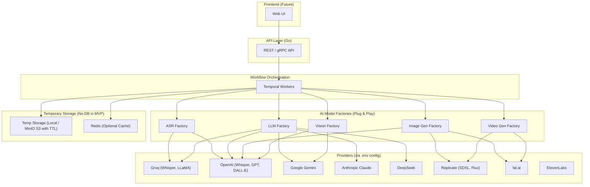

# 🎬 AI Storytelling Video Editor — Sprint Plan

> **Product**: AI Storytelling Video Editor (Go + Temporal)
> **Date**: 2026-11-26
> **Approach**: Easy → Hard, one feature at a time, with testing at every step
> **Architecture**: Factory + Strategy pattern for all AI model integrations and extensible pipelines (plug-and-play)

---

## High-Level Architecture



---

## Factory & Strategy Pattern Design

We combine **Factory** (creation/wiring from `.env` or plan tier) and **Strategy** (interchangeable runtime behavior):

1. **Strategy Pattern (Interfaces & Behavior)**
   - **AI Provider Strategies**: Each AI capability defines a Go interface (`ASRStrategy`, `LLMStrategy`, `ImageGenStrategy`, `VisionStrategy`, `VideoGenStrategy`). Concrete providers implement the strategy, and a `FallbackStrategy` decorator can wrap a primary + backup provider for rate-limit/outage resilience (REQ-076).
   - **Domain Strategies**: Swappable algorithms for **Subtitle Animations** (`Pop`, `Bounce`, `Fade`, `Slide`, `Typewriter`), **Split-Screen Layouts** (`50/50`, `40/60`, `9:16`, `16:9`, `1:1`), **Scene Transitions**, and **Quality Tiers** (`Economy`, `Creator`, `Premium`).
2. **Factory Pattern (Instantiation & Registry)**
   - Factories (`NewASRProvider`, `NewLLMProvider`, `NewImageGenProvider`, etc.) read `.env` config (or the project's quality plan) and return the selected Strategy implementation. Switching providers or behaviors requires zero business-logic changes.

```
internal/
├── ai/
│   ├── asr/           # Speech-to-Text Factory
│   │   ├── factory.go        # ASRProvider interface + NewASRProvider()
│   │   ├── groq_whisper.go   # Groq Whisper implementation
│   │   ├── openai_whisper.go # OpenAI Whisper implementation
│   │   └── deepgram.go       # Deepgram implementation
│   ├── llm/           # LLM Factory
│   │   ├── factory.go        # LLMProvider interface + NewLLMProvider()
│   │   ├── groq.go           # Groq (LLaMA, Mixtral)
│   │   ├── openai.go         # OpenAI (GPT-4o, o1)
│   │   ├── gemini.go         # Google Gemini
│   │   ├── anthropic.go      # Anthropic Claude
│   │   └── deepseek.go       # DeepSeek
│   ├── imagegen/      # Image Generation Factory
│   │   ├── factory.go
│   │   ├── openai_dalle.go
│   │   ├── replicate_flux.go
│   │   └── fal.go
│   ├── vision/        # Vision/Analysis Factory
│   │   ├── factory.go
│   │   ├── openai.go
│   │   └── gemini.go
│   └── videogen/      # Video Generation Factory (P3)
│       ├── factory.go
│       ├── replicate.go
│       └── fal.go
```

---

## `.env` Configuration (All Model Placeholders)

```env
# ============================================================
# APP CONFIG
# ============================================================
APP_ENV=development
APP_PORT=8080
APP_SECRET=your-app-secret

# ============================================================
# CACHE (Optional — DB moved to Future Scope)
# ============================================================
REDIS_URL=redis://localhost:6379

# ============================================================
# TEMPORAL
# ============================================================
TEMPORAL_HOST=localhost:7233
TEMPORAL_NAMESPACE=default
TEMPORAL_TASK_QUEUE=video-processing

# ============================================================
# STORAGE (S3-compatible)
# ============================================================
STORAGE_PROVIDER=minio
S3_ENDPOINT=http://localhost:9000
S3_ACCESS_KEY=minioadmin
S3_SECRET_KEY=minioadmin
S3_BUCKET=reel-assets
S3_REGION=us-east-1

# ============================================================
# ASR (Speech-to-Text) — Factory: "groq" | "openai" | "deepgram"
# ============================================================
ASR_PROVIDER=groq
ASR_MODEL=whisper-large-v3-turbo

# Groq ASR
GROQ_API_KEY=your-groq-api-key
GROQ_ASR_MODEL=whisper-large-v3-turbo

# OpenAI ASR
OPENAI_API_KEY=your-openai-api-key
OPENAI_ASR_MODEL=whisper-1

# Deepgram ASR
DEEPGRAM_API_KEY=your-deepgram-api-key
DEEPGRAM_MODEL=nova-2

# ============================================================
# LLM (Story Understanding, Storyboard, Prompts) — Factory
# Options: "groq" | "openai" | "gemini" | "anthropic" | "deepseek"
# ============================================================
LLM_PROVIDER=groq
LLM_MODEL=llama-3.3-70b-versatile

# Groq LLM
GROQ_LLM_MODEL=llama-3.3-70b-versatile

# OpenAI LLM
OPENAI_LLM_MODEL=gpt-4o

# Google Gemini LLM
GEMINI_API_KEY=your-gemini-api-key
GEMINI_LLM_MODEL=gemini-2.0-flash

# Anthropic LLM
ANTHROPIC_API_KEY=your-anthropic-api-key
ANTHROPIC_LLM_MODEL=claude-sonnet-4-20250514

# DeepSeek LLM
DEEPSEEK_API_KEY=your-deepseek-api-key
DEEPSEEK_LLM_MODEL=deepseek-chat

# ============================================================
# IMAGE GENERATION — Factory
# Options: "openai" | "replicate" | "fal"
# ============================================================
IMAGEGEN_PROVIDER=replicate
IMAGEGEN_MODEL=flux-1.1-pro

# OpenAI DALL-E
OPENAI_IMAGEGEN_MODEL=dall-e-3

# Replicate
REPLICATE_API_KEY=your-replicate-api-key
REPLICATE_IMAGEGEN_MODEL=black-forest-labs/flux-1.1-pro

# fal.ai
FAL_API_KEY=your-fal-api-key
FAL_IMAGEGEN_MODEL=fal-ai/flux-pro/v1.1

# ============================================================
# VISION (Image Analysis / QC) — Factory
# Options: "openai" | "gemini"
# ============================================================
VISION_PROVIDER=openai
VISION_MODEL=gpt-4o

OPENAI_VISION_MODEL=gpt-4o
GEMINI_VISION_MODEL=gemini-2.0-flash

# ============================================================
# VIDEO GENERATION (P3 — Optional) — Factory
# Options: "replicate" | "fal"
# ============================================================
VIDEOGEN_PROVIDER=replicate
VIDEOGEN_MODEL=minimax/video-01-live

REPLICATE_VIDEOGEN_MODEL=minimax/video-01-live
FAL_VIDEOGEN_MODEL=fal-ai/kling-video/v2/master

# ============================================================
# FFMPEG
# ============================================================
FFMPEG_PATH=ffmpeg
FFPROBE_PATH=ffprobe

# ============================================================
# PROCESSING LIMITS
# ============================================================
MAX_VIDEO_DURATION_SEC=600
MAX_FILE_SIZE_MB=500
MAX_IMAGES_PER_SCENE=3
MAX_REGEN_ATTEMPTS=5
MAX_CONCURRENT_JOBS=10
```

---

## Sprint Breakdown

> [!IMPORTANT]
> Each sprint ends with working, tested code. We build foundations first, then layer intelligence on top.

---

### 🏃 Sprint 0 — Project Scaffolding & Infrastructure
**Goal**: Repo structure, build system, Docker dev env, CI skeleton

| # | Task | REQs | Complexity |
|---|------|------|-----------|
| 0.1 | Go module init, folder structure, Makefile | — | Easy |
| 0.2 | Config loader (Viper) + `.env` with all placeholders | REQ-076 | Easy |
| 0.3 | Temp storage helper (Local / MinIO S3 with TTL cleanup) | REQ-088 | Easy |
| 0.4 | Docker Compose (Temporal, MinIO, Redis) | REQ-086 | Easy |
| 0.5 | Temporal SDK setup + hello-world workflow | REQ-086 | Easy |
| 0.6 | HTTP API skeleton (Gin/Echo) + health check | — | Easy |
| 0.7 | AI Factory + Strategy interfaces (ASR, LLM, ImageGen, Vision, VideoGen + Fallback) | REQ-076 | Medium |
| 0.8 | Logging, error handling, middleware | — | Easy |

**Tests**: Config loading, temp storage upload/download, Temporal ping, API health

---

### 🏃 Sprint 1 — Video Upload & Preprocessing
**Goal**: Upload a video, extract audio, detect metadata

| # | Task | REQs | Complexity |
|---|------|------|-----------|
| 1.1 | Video upload endpoint (multipart, progress) | REQ-001 | Medium |
| 1.2 | File validation (format, size, duration) | REQ-001 | Easy |
| 1.3 | Job ID creation + Temporal workflow trigger | REQ-003 | Easy |
| 1.4 | FFmpeg audio extraction activity | REQ-004 | Medium |
| 1.5 | Video metadata detection (duration, fps, resolution) | REQ-004 | Easy |
| 1.6 | Audio normalization | REQ-004 | Easy |
| 1.7 | Low-res preview generation | REQ-004 | Easy |
| 1.8 | Upload → Preprocess Temporal workflow | REQ-003 | Medium |
| 1.9 | Job status tracking API | REQ-003, REQ-089 | Easy |

**Tests**: Upload various formats, validate rejection of bad files, verify audio extraction output, workflow completion, job status transitions

---

### 🏃 Sprint 2 — Speech Recognition (ASR Factory)
**Goal**: Transcribe audio with word-level timestamps using pluggable ASR providers

| # | Task | REQs | Complexity |
|---|------|------|-----------|
| 2.1 | ASR Factory interface + provider registration | REQ-076 | Easy |
| 2.2 | Groq Whisper ASR provider | REQ-005 | Medium |
| 2.3 | OpenAI Whisper ASR provider | REQ-005 | Medium |
| 2.4 | Word-level timestamp extraction + sentence grouping | REQ-006 | Medium |
| 2.5 | Transcript data model + storage | REQ-005 | Easy |
| 2.6 | Transcript quality validation | REQ-060 | Medium |
| 2.7 | ASR Temporal activity (plugged into workflow) | REQ-003 | Easy |
| 2.8 | Transcript API (get, edit) | REQ-007 | Medium |

**Tests**: Transcribe sample audio files, verify timestamps, test provider switching, test transcript editing, quality check edge cases

---

### 🏃 Sprint 3 — Subtitle Generation Engine
**Goal**: Generate synchronized, styled, animated subtitles from transcript

| # | Task | REQs | Complexity |
|---|------|------|-----------|
| 3.1 | Subtitle data model (cues, styling, timing) | REQ-009 | Easy |
| 3.2 | Auto subtitle generation from word timestamps | REQ-009 | Medium |
| 3.3 | Word-by-word highlight timing engine | REQ-010 | Medium |
| 3.4 | Caption template system (pop, bounce, fade, etc.) | REQ-011 | Medium |
| 3.5 | Subtitle customization API (font, color, position) | REQ-012 | Easy |
| 3.6 | Subtitle renderer (burn into video frames — Remotion/FFmpeg) | REQ-009 | Hard |
| 3.7 | Dynamic caption placement logic | REQ-048 | Medium |

**Tests**: Subtitle generation correctness, timing sync, style application, rendering output verification

---

### 🏃 Sprint 4 — LLM Factory + Story Understanding
**Goal**: Plug-and-play LLM providers; understand stories from transcripts

| # | Task | REQs | Complexity |
|---|------|------|-----------|
| 4.1 | LLM Factory interface + provider registration | REQ-076 | Easy |
| 4.2 | Groq LLM provider (LLaMA) | REQ-016 | Medium |
| 4.3 | OpenAI LLM provider (GPT-4o) | REQ-016 | Medium |
| 4.4 | Gemini LLM provider | REQ-016 | Medium |
| 4.5 | Anthropic LLM provider | REQ-016 | Medium |
| 4.6 | DeepSeek LLM provider | REQ-016 | Easy |
| 4.7 | Story analysis prompt chain (characters, events, locations) | REQ-016 | Hard |
| 4.8 | Character Bible generation | REQ-018 | Hard |
| 4.9 | Storyboard generation (scene breakdown + timestamps) | REQ-017 | Hard |
| 4.10 | Narrative continuity tracker | REQ-021 | Hard |
| 4.11 | Scene Director (choose visual type per segment) | REQ-022 | Hard |
| 4.12 | Storyboard quality validation | REQ-061 | Medium |
| 4.13 | Story understanding Temporal activity | REQ-003 | Easy |

**Tests**: Story extraction accuracy with sample transcripts, character bible completeness, scene ordering, continuity validation, provider switching

---

### 🏃 Sprint 5 — Image Generation Factory + Scene Assets
**Goal**: Generate character references and scene illustrations using pluggable providers

| # | Task | REQs | Complexity |
|---|------|------|-----------|
| 5.1 | ImageGen Factory interface + provider registration | REQ-076 | Easy |
| 5.2 | Replicate (Flux) image provider | REQ-027 | Medium |
| 5.3 | fal.ai image provider | REQ-027 | Medium |
| 5.4 | OpenAI DALL-E image provider | REQ-027 | Medium |
| 5.5 | Visual style system (2D cartoon, anime, etc.) | REQ-023 | Medium |
| 5.6 | Auto prompt generation from storyboard + style + character refs | REQ-024 | Hard |
| 5.7 | Character reference sheet generation | REQ-026 | Hard |
| 5.8 | Scene image generation pipeline | REQ-027 | Hard |
| 5.9 | Image storage + asset management | REQ-088 | Easy |
| 5.10 | Image generation Temporal activities | REQ-003 | Medium |

**Tests**: Image generation with each provider, style consistency checks, prompt quality, asset storage/retrieval

---

### 🏃 Sprint 6 — Animation Engine
**Goal**: Animate static illustrations with camera, motion, and transitions

| # | Task | REQs | Complexity |
|---|------|------|-----------|
| 6.1 | Animation event data model | REQ-040 | Medium |
| 6.2 | Action-based animation planner (LLM → animation events) | REQ-040 | Hard |
| 6.3 | Character movement animation primitives | REQ-032 | Hard |
| 6.4 | Object animation primitives | REQ-035 | Medium |
| 6.5 | Environment animation (parallax, weather) | REQ-036 | Medium |
| 6.6 | Camera animation system (pan, zoom, shake) | REQ-037 | Medium |
| 6.7 | Scene transition renderer (fade, crossfade, wipe) | REQ-039 | Medium |
| 6.8 | Animation timeline sync with audio | REQ-040 | Hard |
| 6.9 | Declarative `AnimationRendererStrategy` (FFmpeg procedural + optional Remotion sidecar) | REQ-040 | Medium |

**Tests**: Animation event generation, timeline sync, transition rendering, visual output checks

---

### 🏃 Sprint 7 — Video Composition & Split-Screen
**Goal**: Combine presenter + animation + subtitles into final video

| # | Task | REQs | Complexity |
|---|------|------|-----------|
| 7.1 | Split-screen layout Strategy (`50/50`, `40/60`, vertical stack, horizontal) | REQ-045 | Hard |
| 7.2 | Original presenter video preservation | REQ-044 | Medium |
| 7.3 | Animation panel rendering | REQ-045 | Hard |
| 7.4 | Subtitle overlay compositor | REQ-048 | Medium |
| 7.5 | Multi-aspect-ratio smart reframe & rendering (9:16, 16:9, 1:1) | REQ-065 | Medium |
| 7.6 | Export quality settings (720p, 1080p, 4K) | REQ-066 | Easy |
| 7.7 | Timeline validation | REQ-063 | Medium |
| 7.8 | Final video validation | REQ-064 | Medium |
| 7.9 | Video download API | REQ-067 | Easy |
| 7.10 | Complete end-to-end Temporal workflow | REQ-003/086 | Hard |

**Tests**: Split-screen correctness, aspect ratio handling, subtitle placement, end-to-end rendering, download flow

---

### 🏃 Sprint 8 — Storyboard Editor & Scene Management
**Goal**: User-facing storyboard editor and scene editing

| # | Task | REQs | Complexity |
|---|------|------|-----------|
| 8.1 | Storyboard viewer API (scene cards, previews) | REQ-049 | Medium |
| 8.2 | API-first / agent-native scene editing (declarative JSON patch: description, duration, actions) | REQ-050 | Medium |
| 8.3 | Scene regeneration endpoint | REQ-050 | Medium |
| 8.4 | Visual style selection API | REQ-023 | Easy |
| 8.5 | Processing stage transparency API | REQ-089 | Easy |
| 8.6 | Processing cost estimation | REQ-090 | Medium |

**Tests**: Scene CRUD, regeneration flow, style switching, cost calculation accuracy

---

### 🏃 Sprint 9 — Billing, Plans & Resource Control
**Goal**: Credit-based billing, quality tiers, resource limits

| # | Task | REQs | Complexity |
|---|------|------|-----------|
| 9.1 | Quality plan system (Economy / Creator / Premium) | REQ-074 | Medium |
| 9.2 | Credit tracking per AI usage type | REQ-075 | Medium |
| 9.3 | Cost estimation before processing | REQ-075 | Medium |
| 9.4 | Resource limit enforcement | REQ-090 | Medium |
| 9.5 | Per-user concurrency limits | REQ-090 | Easy |
| 9.6 | Job cancellation | REQ-090 | Easy |

**Tests**: Credit deduction accuracy, limit enforcement, plan tier model selection, cancellation cleanup

---

### 🏃 Sprint 10+ — Future Scope (DB, Persistence & P2/P3 Features)
**Goal**: Add PostgreSQL persistence and advanced creator features on top of the stateless upload → result pipeline

| Priority | Features |
|----------|----------|
| **DB / Persistence** | PostgreSQL + `golang-migrate`, Project CRUD & history (REQ-002), persistent asset/video retention (REQ-088/091), user accounts & credit-based billing persistence (REQ-075) |
| **P2** | Silence/pause trimming (Vedit-style), speaker detection (REQ-008), keyword emphasis (REQ-013), emoji integration (REQ-014), subtitle export (REQ-015), environment bible (REQ-019), object library (REQ-020), emotion-aware direction (REQ-025), character consistency validation (REQ-028/029), multi-candidate images (REQ-030), image regeneration (REQ-031), facial expressions (REQ-033), character interactions (REQ-034), visual effects (REQ-038), stateful animation (REQ-041), animation density (REQ-043), dynamic panels (REQ-046), face protection (REQ-047), libraries (REQ-051/052/053), prompt editing (REQ-054), undo/history (REQ-055), scene approval workflow (REQ-056), audio features (REQ-057/058/059), image quality check (REQ-062), brand kit (REQ-069), templates (REQ-070), analytics (REQ-078), scene density (REQ-081), cost optimization (REQ-084) |
| **P3** | AI video generation (REQ-042), content packaging (REQ-071), batch processing (REQ-072), team workspaces (REQ-073), public API (REQ-077), story universe (REQ-079), personalized style (REQ-082), story series (REQ-083), auto quality improvement (REQ-085) |

---

## Sprint Execution Rules

> [!TIP]
> **How we work sprint by sprint:**

1. **One sprint at a time** — finish and test before moving on
2. **Every feature gets tests** — unit tests + integration tests
3. **Factory + Strategy everywhere** — Factories wire implementations from `.env`/plan config; Strategies keep AI providers, fallback chains, animations, and layouts cleanly swappable
4. **Temporal activities are idempotent** — safe to retry
5. **PRs are small and focused** — one task = one commit
6. **We validate after each sprint** — run the full flow manually

---

## Tech Stack Summary

| Layer | Technology |
|-------|-----------|
| **Language** | Go 1.22+ |
| **API** | Gin or Echo |
| **Orchestration** | Temporal.io |
| **Database** | *None for MVP* (PostgreSQL + `golang-migrate` in Future Scope) |
| **Cache/Queue** | Redis (optional) |
| **Storage** | Local Temp / MinIO (S3-compatible with TTL cleanup) |
| **Media** | FFmpeg |
| **Animation** | Remotion (Node.js sidecar) or programmatic FFmpeg |
| **Config** | Viper + `.env` |
| **Testing** | Go `testing` + testify + testcontainers |
| **Containers** | Docker + Docker Compose |

---

## Ready?

> [!IMPORTANT]
> **Sprint 0** is up first: project scaffolding, Docker infra, config system, and all AI factory interfaces.
>
> Say **"Let's start Sprint 0"** and we'll begin building! 🚀
